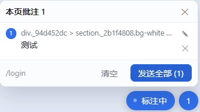

# dsh-webannotate

在 DeepSeek Harness 的**内置浏览器**里给网页做批注：点元素 → 写一句要怎么改 → 「发送全部」→ 批注作为一条消息进当前对话，每条附一张该元素的截图。

装插件即用，不改被标注项目的任何代码，本地 dev 站点和已部署的线上站点都能标。

## 它解决什么

网页上的问题（间距不对、这个按钮太挤、这段文案换个说法）用文字描述很难指清楚，尤其页面有很多子页面时。这个插件把「指哪改哪」变成两步：点一下元素、写一句话，然后整批发给对话里的 agent。

## 和「在页面里引入标注脚本」的区别

DSH 桌面版的内置浏览器用 Electron `<webview>` 承载页面，页面处在独立 origin，GUI（插件运行的地方）无法直接访问它的 DOM。所以常见的注入式方案（Agentation 之类）需要往每个项目里加依赖和 `<script>`。

这里换了个方向：插件的 client 半就跑在 GUI 页面里，和 `<webview>` 元素同处一个文档，于是可以

```
webview.executeJavaScript(overlay)   // 注入批注层
webview.executeJavaScript(outbox())  // 每 700ms 取回批注
webview.capturePage()                // 每条批注截一张图
```

不需要反向代理、不需要 CDP、不需要改站点，任意 URL 都能用。

## 安装

从 npm 装：

```bash
dsh plugin --profile desktop add dsh-webannotate
```

或者直接从 GitHub 装：

```bash
dsh plugin --profile desktop add github:FleatherYu/dsh-webannotate
```

安装后**完整退出并重启一次** DSH（插件的 client 半在 host 启动时组装），然后在右侧栏打开内置浏览器、访问任意页面。

本地开发用 `link:` 挂自己改的目录：

```bash
dsh plugin --profile desktop add "link:/路径/dsh-webannotate"
```

## 用法



1. 在内置浏览器打开页面，右下角出现「批注」按钮。
2. 点它进入标注模式，鼠标移到元素上会高亮，点一下就弹出评论框。
3. 写一句要怎么改，`Ctrl+Enter` 或「保存」；保存后元素右上角出现编号。
4. 继续标下一条；数字按钮显示本页批注数量，点开是列表（定位 / 编辑 / 删除 / 清空）。
5. 点「发送全部」，批注作为一条消息进入当前对话，每条配一张该元素的截图。

批注按「页面」分开存（`sessionStorage`，key 是 origin + pathname）：同一页刷新或来回切标签页仍在，跳到别的页面则各存各的，跳回去还能看到。

## 消息长什么样

```text
【网页批注】2 处 · 预算
页面：http://localhost:5173/budget
截图：2 张（编号对应）

1. 「保存」 字号大一点
   源码：src/pages/Budget.tsx:42
2. 「年 · 月」 排到上面去
   组件：BudgetPage > MonthSwitch
```

- 元素可见文本 + 你那句话：定位靠截图和这一行。
- `源码：` 只在开发模式（有 React `_debugSource`）时出现；`组件：` 是压缩名过滤后的组件链。原始 CSS 选择器只在有 `id` / `data-testid` / `aria-label` / `name` 时附带。
- 元素量不出位置（弹层已关、列表重渲染）时这条**静默跳过**截图，文字照常发送。

## 结构

| 文件 | 作用 |
| --- | --- |
| `index.js` | Host 半：`GET /dsh-webannotate/overlay.js`（现读文件，改完不用重启）、`POST /report`、`/batch`、`GET /status` 诊断，和 `webannotate_status` 工具。 |
| `client.js` | Client 半：扫描 `<webview>`、注入 overlay、轮询批注、截图、把批次作为一条消息发进当前会话。 |
| `web/overlay.js` | 注入页面里的批注层（纯 IIFE、Shadow DOM 隔离，无依赖）。 |

## 已知限制

- 只能标顶层文档：跨域 iframe 内的元素标不到。
- 内置浏览器面板关掉后 `webview` 不在 DOM 里，批注层随之暂停。
- SPA 内部路由切换后，旧的编号可能定位不到原来的元素（列表里会提示）。
- 每条最多一张截图、单批最多 6 张，超出部分不发图。

## 开发

```bash
node --check client.js
node --check web/overlay.js
```

改 `web/overlay.js` 后刷新被标注页面即可（host 每次请求现读文件）；改 `client.js` 后刷新 DSH 页面；首次新增或修改 `package.json` 的 `dsh.client` 声明需要重启 DSH。

更细的排障记录见 [HANDOFF.md](HANDOFF.md)。

## License

MIT
